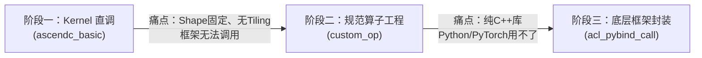
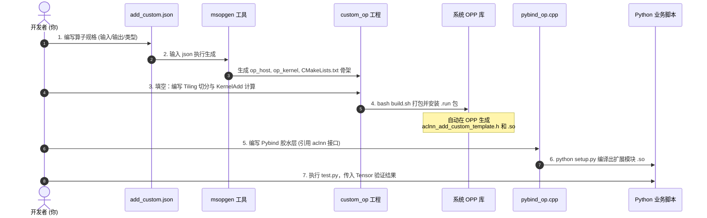

# vector算子开发

## 章节介绍：
本章聚焦Vector算子的Tiling开发、网络中的算子调用方式，以及泛化算子开发的核心要点

学习针对不同规模输入数据设计优化Tiling策略的方法，最终开发出支持任意输入大小的高效算子

## 章节目标：
1. 理解Tiling的基本原理
2. 掌握单算子API调用和pybind调用
3. 掌握任意大小输入时Tiling设计和实现

------

感到迷糊是**极其正常且必然的经历**！

你之所以觉得复杂，是因为在这短短几天里，你一个人把**芯片硬件架构师、C++ 系统工程师、CMake 构建工程师、底层驱动工程师、再到上层 PyTorch 框架工程师**长达数年的全栈链路从头到尾全部走了一遍！

为了让你不再迷茫，我们今天抛开所有零碎的细枝末节，**从上帝视角为你彻底梳理一遍：从硬件到 Python、从本地到云端、从代码到调用的“终极全景图”**。

---

### 第一部分：为什么要这么折腾？（三阶段演进的本质逻辑）

很多人学到最后会困惑：*“我明明在第一阶段（Kernel 直调）写个 `.asc` 就能算了，为什么非要搞出算子工程、OPP、Pybind 这一大堆复杂的东西？”*

我们来看这三个阶段究竟在解决什么实际问题：



| 阶段 | 你写的代码 | 它做的事情 | 它解决了什么？ | 它还缺什么？ |
| :--- | :--- | :--- | :--- | :--- |
| **阶段一：Kernel 直调**<br>（单兵作战） | `add_custom.asc` | 纯手写 NPU 上的搬运和矢量加法（`CopyIn -> Compute -> CopyOut`）。 | 搞懂了 NPU 的内部构造（AI Core、UB、Queue、Double Buffer）。 | **数据长度是写死的**！无法处理任意维度动态输入，且只能写纯 C++ `main` 函数用专用编译器跑，PyTorch 根本不认识它。 |
| **阶段二：规范算子工程**<br>（工业化流水线） | `op_host/` (Tiling)<br>`op_kernel/` (计算) | 把“怎么切分数据（Tiling）”和“具体怎么算（Kernel）”拆开，打包成标准 `.run` 并安装进系统。 | **支持了任意维度动态 Shape**，并且向系统注册，自动生成了官方标准的单算子执行接口（`aclnnAddCustomTemplate`）。 | 算子虽然造好了、也登记进系统了，但它依然是底层的 C++ 动态库，**算法工程师无法在 Python 里直接调**。 |
| **阶段三：Pybind 框架封装**<br>（最终交付商用） | `pybind_op.cpp`<br>`setup.py` | 用 Pybind11 和 PyTorch C++ 扩展，把底层的 `aclnn` 接口包装成 Python 函数。 | **实现了与 PyTorch 无缝对接**！在 Python 里写 `out = custom_ops_lib.npu_add(...)` 就能跑。 | **至此，开发闭环完全达成！** |

---

### 第二部分：空间与实体地图（本地、云端、目录与环境）

你困惑的另一大根源是：*文件到底存哪了？系统到底在哪里运行？* 我们把涉及的“三地、三目录、两环境”彻底理清：

#### 1. 物理位置的三地分工
* **本地（你的电脑 WSL）**：纯文本编辑器。只负责写代码、Git 提交，**不运行、不编译**。
* **云端托管（GitHub / GitCode）**：中转网盘。用来把本地写好的纯代码搬运到云端。
* **云端算力（华为 Web IDE 容器）**：真实执行工厂。拥有 CANN 工具链，**负责一切编译、安装、运行**。

#### 2. 云端 Web IDE 里的“核心三目录”
在云端 Web IDE 容器里，有三个完全不同的文件夹，不要搞混：

```text
/home/developer/
├── Ascend/cann-9.0.0/             <--- 目录 ①：【CANN 官方工具箱】(官方安装好的编译器、开发工具)
│   └── opp/vendors/customize/     <--- 目录 ②：【系统算子库 OPP】(你编译安装后的最终产物存放地)
│       └── op_api/
│           ├── include/           (生成的 aclnn 头文件)
│           └── lib/               (生成的 libcust_opapi.so 库)
│
└── /mnt/workspace/CANN_ict/       <--- 目录 ③：【你的源码工作区】(你从 Git 克隆下来的个人代码)
    └── ascendc_operator_development/
        └── vector_op_development/
            ├── custom_op/         (你的算子工程源码)
            └── acl_pybind_call/   (你的 Python 封装源码)
```

#### 3. 环境变量到底在干嘛？
* **`ASCEND_TOOLKIT_HOME`**：告诉系统，“官方工具箱在 `/home/developer/Ascend/cann-9.0.0`”。
* **`LD_LIBRARY_PATH`**：告诉动态链接器，“运行 Python 时，去哪里找底层的 `.so` 动态库（包括昇腾基础库和你的自定义算子库）”。
* 这就是为什么新开终端必须执行一次 `source scripts/env_setup.sh`，就是为了把这两条路标告诉 Linux 系统。

---

### 第三部分：从 0 到 1 的开发落地全生命周期（七步全流程拆解）

这是整个过程最关键的一章。我们从创建第一个文件开始，一步一步看数据和代码是如何流转的：



---

#### 步骤 1：需求定义（`add_custom.json`）
* **你在做什么**：在纸上画图纸。告诉系统：“我要做一个叫 `AddCustomTemplate` 的算子，有两个输入 `x` 和 `y`，一个输出 `z`，支持 float16 和 float32”。
* **产出**：`add_custom.json`。

#### 步骤 2：生成工程骨架（`msopgen`）
* **你在做什么**：执行工具命令：`msopgen -i add_custom.json -c ai_core-ascend910b -lan cpp -out custom_op`。
* **产出**：自动生成标准的 `custom_op` 目录结构（包括 `op_host`、`op_kernel`、`CMakeLists.txt`、`build.sh`）。

#### 步骤 3：核心逻辑实现（Host 与 Kernel 协同）
* **你在做什么**：在生成的工程骨架中填入真实算法：
  1. **Host 侧（[op_host/add_custom_template.cpp](file:///home/equinoxmaple/CANN_ict/ascendc_operator_development/vector_op_development/custom_op/op_host/add_custom_template.cpp)）**：在 CPU 上运行。计算 `data_sz`，决定每个核分多少数据（`tileNum`、`blockDim`），这叫 **Tiling**。
  2. **Kernel 侧（[op_kernel/add_custom_template.cpp](file:///home/equinoxmaple/CANN_ict/ascendc_operator_development/vector_op_development/custom_op/op_kernel/add_custom_template.cpp)）**：在 NPU 内部运行。实现 `KernelAdd` 类，通过 `CopyIn -> Compute -> CopyOut` 真正操作硬件的 Unified Buffer 算加法。

#### 步骤 4：编译打包与安装（`build.sh` -> `.run` -> OPP）
* **你在做什么**：执行 `bash scripts/build_and_deploy.sh`。
* **底层发生了什么**：
  1. 交叉编译器（`ccec`）把 `op_kernel` 编译成 NPU 机器码二进制；
  2. CMake 把 `op_host` 编译，**并自动生成单算子 API（ACLNN）**；
  3. 打包成 `build_out/custom_opp_*.run` 并自动执行安装；
  4. **关键质变**：算子被正式部署进系统的 **OPP 目录**：
     * 生成了头文件：`aclnn_add_custom_template.h`
     * 生成了动态库：`libcust_opapi.so`
  > 此时，算子已经在操作系统中“上牌落户”了。

#### 步骤 5：编写胶水层（`pybind_op.cpp`）
* **你在做什么**：既然系统里已经有了 `aclnn_add_custom_template.h`，你在 `acl_pybind_call/pybind_op.cpp` 里写代码去调用它：
  ```cpp
  #include "aclnn_add_custom_template.h"
  #include "pytorch_npu_helper.hpp"

  at::Tensor npu_add_custom_template(const at::Tensor &x, const at::Tensor &y) {
      at::Tensor z = at::empty_like(x);
      // 调用第 4 步生成的底层 ACLNN 接口！
      EXEC_NPU_CMD(aclnnAddCustomTemplate, x, y, z);
      return z;
  }
  // 用 PYBIND11 暴露给 Python
  PYBIND11_MODULE(TORCH_EXTENSION_NAME, m) {
      m.def("npu_add_custom_template", &npu_add_custom_template);
  }
  ```

#### 步骤 6：编译 Python 扩展库（`setup.py`）
* **你在做什么**：在终端执行：
  ```bash
  python3 setup.py build_ext --inplace
  ```
* **底层发生了什么**：
  `setuptools` 调用 GCC，读取 `pybind_op.cpp`，链接第 4 步安装好的 `libcust_opapi.so`，编译出一个 Python 可以直接识别的动态链接库：
  `custom_ops_lib.cpython-311-x86_64-linux-gnu.so`。

#### 步骤 7：最终业务调用（`test_add.py`）
* **你在做什么**：在最上层享受成果！
  ```python
  import torch
  import torch_npu
  import custom_ops_lib  # 就是步骤 6 编译出来的 .so

  # 准备数据放到 NPU
  x = torch.randn(8, 2048, dtype=torch.float16).npu()
  y = torch.randn(8, 2048, dtype=torch.float16).npu()

  # 一行代码触发全部底层硬件链路！
  out = custom_ops_lib.npu_add_custom_template(x, y)

  # 与 CPU 标杆对齐精度
  assert torch.allclose(out.cpu(), x.cpu() + y.cpu())
  print("验证通过！")
  ```

---

### 第四部分：一图串联所有层次架构（从 Python 到芯片）

当你执行最后那一行 `out = custom_ops_lib.npu_add_custom_template(x, y)` 时，整个技术栈是这样自顶向下逐层击穿的：

```text
【Python 业务层】:  out = custom_ops_lib.npu_add_custom_template(x, y)
       │
       ▼ (Pybind11 跨语言转换)
【C++ 胶水层】:    npu_add_custom_template() 接收 at::Tensor (pybind_op.cpp)
       │
       ▼ (宏展开 EXEC_NPU_CMD)
【单算子调度层】:   aclnnAddCustomTemplateGetWorkspaceSize -> 申请内存 -> aclnnAddCustomTemplate (libcust_opapi.so)
       │
       ▼ (Host 侧 Tiling 执行)
【切分调度层】:    TilingFunc 计算数据切块策略 (op_host/add_custom_template.cpp)
       │
       ▼ (CANN Runtime 下发指令到 Stream 流)
【驱动运行时】:    驱动将核函数二进制和 Tiling 参数载入 NPU
       │
       ▼ (硬件实际计算)
【昇腾 AI Core】:   KernelAdd 类执行 CopyIn -> Compute -> CopyOut，UB 与 GM 搬运计算 (op_kernel/)
```

---

### 总结与通关锦囊

回顾整条路径，你可以把它简化为**三个角色**：
1. **`op_kernel`**：在 NPU 上干体力活的工人（怎么搬数据、怎么做加法）。
2. **`op_host` + `build.sh`**：在 CPU 上的调度指挥官，给工人分配工作（Tiling），并向系统登记（OPP）。
3. **`pybind_op` + `setup.py`**：对外接待的前台，把工人和指挥官的成果包装成 Python 用户听得懂的语言。

现在，你手里的代码已经覆盖了这三个角色的全部核心。只要按照这个结构，以后无论面对多么复杂的矩阵乘（Matmul）、注意力机制（FlashAttention）还是自定义算子，**整个流程和范式都是 100% 完全通用的**！
